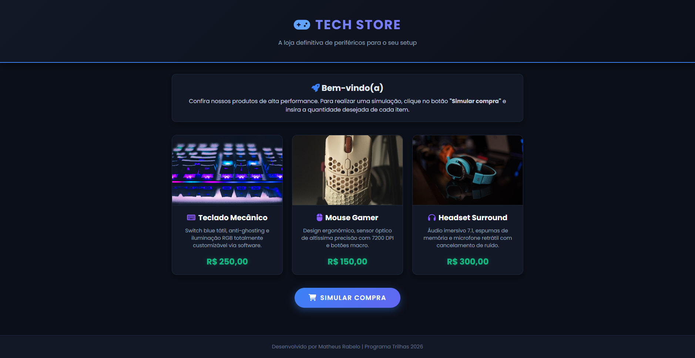

# Simulador de Compras - Tech Store

**Projeto:** Desafio 1 — Minha Loja: Simulador de Compras  
**Aluno:** Matheus Rabelo de Freitas 
**Trilha:** Desenvolvimento Mobile | Programa Trilhas 2026  

## 🛒 Apresentação da Loja
A **Tech Store** é uma loja virtual fictícia moderna focada em periféricos e equipamentos de alta performance para computadores. O objetivo da página é exibir um catálogo interativo e permitir a simulação de uma compra com cálculo automático de valores.

### Produtos e Preços:
- **Teclado Mecânico:** R$ 250,00
- **Mouse Gamer:** R$ 150,00
- **Headset Surround:** R$ 300,00

## 💻 Tecnologias Utilizadas
- **HTML5:** Estruturação semântica da página, cartões de produtos e botões.
- **CSS3:** Estilização visual avançada com tema escuro (Dark Mode), design responsivo em grid e fontes do Google Fonts.
- **JavaScript:** Lógica de interatividade, captura de quantidades via `prompt()`, validação de dados inteiros/números, cálculos aritméticos e exibição de extrato via `alert()`.
- **FontAwesome:** Ícones vetoriais modernos para a interface.

## 🚀 Instruções de Execução
1. Faça o download ou clone este repositório para o seu computador.
2. Certifique-se de que os ficheiros `index.html`, `style.css`, `script.js` e a pasta `assets/` estão na mesma pasta.
3. Dê um duplo clique no ficheiro `index.html` para abri-lo no seu navegador padrão.
4. Na página da loja, clique no botão **"Simular Compra"**.
5. Insira a quantidade desejada de cada item nas janelas que irão aparecer.
6. Confira o resumo detalhado da compra e o valor total a pagar gerado pelo sistema.

## 🖼️ Captura de Tela

## 🧪 Testes Realizados
1. **Compra Padrão:** Inserção de quantidades normais (ex: 1 teclado e 2 mouses). O sistema calculou o subtotal por produto e somou corretamente no valor total final.
2. **Nenhuma Compra:** Inserção de `0` ou cancelamento em todas as perguntas. O sistema identificou que nenhum item foi escolhido e emitiu o alerta de cancelamento.
3. **Validação de Erro:** Tentativa de digitar letras ou caracteres inválidos. O sistema validou a entrada através de um loop, bloqueando textos e exigindo um número inteiro válido.

## 🧠 Dificuldade Encontrada e Aprendizado
A principal dificuldade inicial foi garantir a responsividade uniforme das imagens dos produtos em cartões compactos, visto que as fotografias originais possuíam proporções diferentes. A solução foi aplicar técnicas avançadas de CSS (como `aspect-ratio` e `object-fit: cover`) combinadas com um tema escuro unificado. Com isso, aprendi a estruturar interfaces mais limpas, profissionais e adaptáveis a diferentes ecrãs.

## 🤖 Uso de IA
A inteligência artificial foi utilizada como ferramenta de apoio para estruturar o layout moderno em CSS e otimizar a lógica de validação de dados em JavaScript. Todo o código gerado foi devidamente revisado, testado e compreendido para garantir a total conformidade com os objetivos pedagógicos da trilha.
